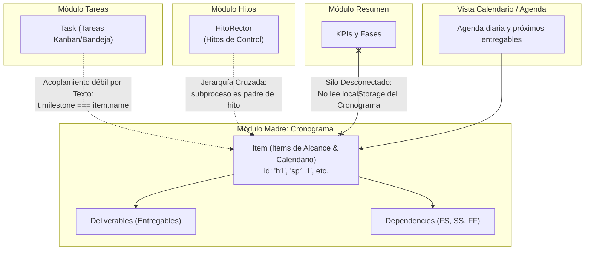
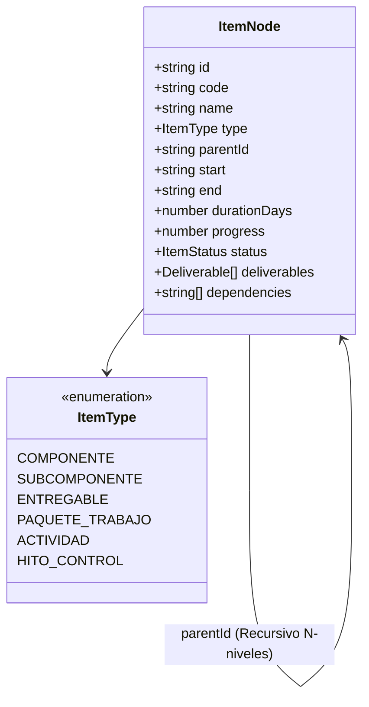

# AUDITORÍA ARQUITECTÓNICA Y METODOLÓGICA
## Reorganización Metodológica del Módulo Madre (Cronograma y Gestor de Proyectos)
**Fecha:** 04/11/2026  
**Proyecto:** Gestor de Proyectos Regionales · Qaway Lab (MINEDU · Dotación 2027)  
**Módulo auditado:** Cronograma Gantt Maestro (`src/modules/cronograma-gantt`)  

---

### 1. DIAGNÓSTICO DEL ESTADO ACTUAL

Tras la inspección estricta del código fuente en `CronogramaGanttView.tsx`, `CronogramaArbolView.tsx`, `TareasView.tsx`, `HitosView.tsx` y las capturas reales de la interfaz (Gantt, Lista, Calendario/Agenda y KPIs), se concluye lo siguiente:

1. **La base operativa y el motor visual son 100% funcionales y robustos:** 
   El sistema cuenta con un motor reactivo en memoria sincronizado con `localStorage` (`qaway-gantt-items-v1`), un motor de renderizado Gantt SVG con dependencias ortogonales paramétricas, un motor de columnas configurable por vista (`src/shared/table-engine`), y 5 vistas sincronizadas (Gantt, Lista, Kanban, Calendario y Jerárquica).
2. **El problema no es de código ni de diseño; es de taxonomía conceptual:**
   El modelo de datos actual fue forzado a un esquema binario rígido: `kind: 'hito' | 'subproceso'`. 
   - Todo contenedor de primer nivel fue etiquetado arbitrariamente como **"Hito"**, dotándolo erróneamente de duración (88 días, 142 días), fechas de inicio/fin y progreso porcentual.
   - Todo elemento hijo fue etiquetado como **"Subproceso"**, cuando en realidad representa paquetes de trabajo de entrega única o actividades programables.
3. **Condición rectora:** 
   No se debe reescribir la UI ni rehacer el motor de renderizado. La solución consiste en **desacoplar el rol metodológico del elemento (`type`) de su rol estructural en el árbol (`parentId`)**, permitiendo que el sistema mantenga intactos sus IDs, cálculos y enlaces, pero llamando a cada concepto por su nombre técnico correcto.

---

### 2. INVENTARIO DE ENTIDADES Y MODELOS

#### A. Entidades del Módulo Cronograma Gantt (`CronogramaGanttView.tsx`)

| Interfaz / Tipo | Atributos clave | Rol en el sistema | Persistencia |
|---|---|---|---|
| `Item` | `id: string`<br>`code: string`<br>`name: string`<br>`kind: 'hito' \| 'subproceso'`<br>`parentId?: string`<br>`start: string`<br>`end: string`<br>`progress: number`<br>`status: 'pendiente' \| 'en_proceso' \| 'completado' \| 'retrasado'`<br>`dependencies?: string[]`<br>`deliverables?: Deliverable[]`<br>`gestor?: string`<br>`region?: string` | Entidad central polimórfica que alimenta el Gantt, la Lista, el Kanban y el Calendario. Soporta jerarquía padre-hijo mediante `parentId`. | `localStorage['qaway-gantt-items-v1']` (con fallback a `INITIAL_ITEMS`) |
| `Deliverable` | `id: string`<br>`code: string`<br>`name: string`<br>`status: 'pendiente' \| 'en_revision' \| 'aprobado' \| 'observado'`<br>`dueDate: string`<br>`responsible?: string`<br>`evidenceCount?: number` | Entregables documentales o técnicos asociados a un `Item`. Permiten verificar la culminación de un trabajo. | Integrado dentro de `Item.deliverables` |
| `Dependency` | `fromId: string`<br>`toId: string`<br>`type: 'FS' \| 'SS' \| 'FF' \| 'SF'`<br>`lagDays?: number` | Precedencias entre barras temporales para cálculo de cascada y dibujo de conectores SVG ortogonales. | Array `dependencies` en cada `Item` |

#### B. Entidades de Módulos Satélites

| Módulo | Entidad técnica | Atributos de vinculación | Problema detectado |
|---|---|---|---|
| **Tareas** (`TareasView.tsx`) | `Task` | `milestone?: string`<br>`subproceso?: string` | Se enlaza por **texto plano** (`t.milestone === item.name`). Si se corrige el nombre o código del hito, el enlace se rompe. |
| **Hitos** (`HitosView.tsx`) | `HitoRector` | `id: string`<br>`subproceso: string` | **Jerarquía invertida:** En este módulo el `subproceso` es el padre y el `Hito` es el hijo, exactamente al revés que en el Cronograma. |
| **Resumen** (`ResumenProyectoView.tsx`) | `PhaseMetric` | Estático (`PHASES`) | Trabaja como un silo aislado con datos mock fijos; no lee el estado vivo del Cronograma. |
| **Equipo** (`EquipoView.tsx`) | `Integrante` | `frentes: string[]` | Vinculación por nombre de frente territorial/ámbito, no por ID de entregable. |

---

### 3. CLASIFICACIÓN METODOLÓGICA DE LOS ELEMENTOS EXISTENTES

Analizando los 36 registros iniciales (`INITIAL_ITEMS`), se identifica la discordancia entre lo que el sistema dice que son y su verdadera naturaleza técnica:

| Elemento actual | Nombre visible | Tipo técnico actual | Función real | Clasificación metodológica propuesta | Observaciones |
|---|---|---|---|---|---|
| `h1` | Planificación de la distribución y conformación de comités | `kind: 'hito'` | Agrupa la planificación normativa, comités y directivas territoriales. Dura 88 días. | **Componente de Alcance / Fase** | No es un hito. Consume tiempo, recursos y contiene 7 actividades/paquetes. |
| `sp1.1` | Aprobación de la Directiva de Distribución | `kind: 'subproceso'` | Emisión formal de resolución y directiva con criterios de validación. | **Entregable / Hito de Aprobación** | Produce un documento legal concreto. El evento de firma es un hito de aprobación. |
| `sp1.2` | Conformación de Comités Territoriales | `kind: 'subproceso'` | Gestión operativa de designación de integrantes en UGELs. | **Paquete de Trabajo / Actividad** | Implica trabajo repetitivo de coordinación y gestión territorial. |
| `sp1.3` | Publicación del Padrón de II.EE. | `kind: 'subproceso'` | Validación y congelamiento de la nómina de escuelas beneficiarias. | **Entregable / Hito de Control** | Base de datos validada que autoriza el cálculo de material. |
| `h2` | Gestión de Almacenes y Recepción en MC SIGA | `kind: 'hito'` | Operación logística de almacenamiento, ingreso a SIGA y control de stock. Dura 142 días. | **Componente Operativo** | Es un bloque mayor del alcance que agrupa procesos logísticos y de almacén. |
| `sp2.1` | Identificación y directorio de almacenes | `kind: 'subproceso'` | Censo y registro físico de locales de acopio regional. | **Paquete de Trabajo** | Produce el entregable "Directorio oficial de almacenes". |
| `sp2.2` | Registro de recepción de materiales (RAR / NEA) | `kind: 'subproceso'` | Verificación física y asiento contable en el SIGA MINEDU. | **Actividad / Proceso Operativo** | Trabajo continuo de registro guiado por reglas BPMN. |
| `sp2.3` | Validación física de almacenes territoriales | `kind: 'subproceso'` | Inspección técnica in situ de capacidad y seguridad. | **Actividad de Control / Inspección** | Trabajo de campo con acta de conformidad. |
| `h3` | Distribución y Transporte a II.EE. | `kind: 'hito'` | Ejecución del traslado de material educativo a instituciones educativas. Dura 116 días. | **Componente / Macroproceso** | Es el corazón de la distribución física territorial. |
| `sp3.1` | Preparación de expedientes de contratación de transporte | `kind: 'subproceso'` | Elaboración de TDRs y contratación de proveedores de ruta. | **Paquete de Trabajo** | Concluye con contratos suscritos. |
| `sp3.2` | Coordinación de rutas críticas y transporte fluvial | `kind: 'subproceso'` | Monitoreo y ejecución de despachos fluviales y terrestres. | **Proceso Operativo / Flujo** | Despacho secuencial sujeto a condiciones climáticas y geográficas. |
| `sp3.3` | Entrega física y actas de recepción con directores | `kind: 'subproceso'` | Traspaso del material y suscripción de actas en cada escuela. | **Actividad Operativa Masiva** | Produce las actas físicas y digitales que sustentan la pecosa. |
| `h4` | Cierre, PECOSA y Consolidado Regional | `kind: 'hito'` | Liquidación administrativa y contable del proceso de entrega. | **Componente de Cierre** | Fase final de rendición de cuentas y regularización SIGA. |
| `sp4.1` | Emisión y conciliación de PECOSA en SIAGIE | `kind: 'subproceso'` | Cierre de pedidos y concordancia entre almacén y sistema escolar. | **Entregable Formal** | Registro digital consolidado. |
| `sp4.2` | Liquidación de contratos de transporte | `kind: 'subproceso'` | Conformidad de servicio y pago a transportistas. | **Paquete de Trabajo** | Tramitación financiera y contractual. |
| `h5` | Informe Técnico Final MINEDU - DIGERE | `kind: 'hito'` | Redacción y presentación del balance de dotación 2027. | **Entregable Principal de Cierre** | Es un entregable documental mayor que culmina en un hito de aprobación ministerial. |
| `H-03` | Acta de conformidad y asignación presupuestal | `kind: 'hito'` (en Calendario) | Evento de aprobación que habilita fondos operativos. Duración: 0 días. | **Hito de Decisión (Milestone)** | Este SÍ es un verdadero hito metodológico (punto de control temporal puntual). |

---

### 4. ÁRBOL JERÁRQUICO REAL

Estructura actual en código de `INITIAL_ITEMS` (36 registros en 9 ramas):

```text
Proyecto: Programa Maestro Operativo 2027 (PRJ-OPS-2027-01)
│
├── [CÓD: 1.] Planificación de la distribución y conformación de comités [Contenedor | Dura: 88d | Prog: 67%]
│   ├── [CÓD: 1.1] Aprobación de Directiva Regional [Hoja | Dura: 15d | Prog: 100% | Entregable: Directiva Aprobada]
│   ├── [CÓD: 1.2] Conformación de Comités UGEL [Hoja | Dura: 20d | Prog: 90% | Entregable: Actas de Comité]
│   ├── [CÓD: 1.3] Validación de Matriz de Distribución [Hoja | Dura: 25d | Prog: 70% | Entregable: Matriz Validada]
│   └── [CÓD: 1.4] Publicación del Padrón de II.EE. Beneficiarias [Hoja | Dura: 10d | Prog: 0%]
│
├── [CÓD: 2.] Gestión de Almacenes y Recepción en MC SIGA [Contenedor | Dura: 142d | Prog: 42%]
│   ├── [CÓD: 2.1] Identificación y directorio de almacenes [Hoja | Dura: 30d | Prog: 100% | Entregable: Directorio]
│   ├── [CÓD: 2.2] Registro de recepción de materiales (RAR / NEA) [Hoja | Dura: 45d | Prog: 50%]
│   ├── [CÓD: 2.3] Validación física de almacenes territoriales [Hoja | Dura: 30d | Prog: 0%]
│   └── [CÓD: 2.4] Corte y consolidación de stock regional [Hoja | Dura: 20d | Prog: 0%]
│
├── [CÓD: 3.] Distribución y Transporte a II.EE. [Contenedor | Dura: 116d | Prog: 18%]
│   ├── [CÓD: 3.1] Preparación de expedientes de contratación [Hoja | Dura: 25d | Prog: 60%]
│   ├── [CÓD: 3.2] Coordinación de rutas críticas y transporte fluvial [Hoja | Dura: 40d | Prog: 10%]
│   └── [CÓD: 3.3] Entrega física y actas de recepción con directores [Hoja | Dura: 45d | Prog: 0%]
│
├── [CÓD: 4.] Cierre, PECOSA y Consolidado Regional [Contenedor | Dura: 30d | Prog: 0%]
│   ├── [CÓD: 4.1] Emisión y conciliación de PECOSA en SIAGIE [Hoja | Dura: 20d | Prog: 0%]
│   └── [CÓD: 4.2] Liquidación de contratos de transporte [Hoja | Dura: 15d | Prog: 0%]
│
├── [CÓD: 5.] Informe Técnico Final MINEDU - DIGERE [Contenedor | Dura: 30d | Prog: 0%]
│   └── [CÓD: 5.1] Consolidación de evidencias fotográficas y actas [Hoja | Dura: 15d | Prog: 0%]
│
└── [CÓD: 6. - 9.] Hitos genéricos en borrador ("Nuevo hito") [Contenedores | Dura: 36d - 61d | Prog: 0%]
    └── (Subprocesos de reserva sin configurar)
```

**Propiedades estructurales:**
* **Contenedores:** Elementos `kind: 'hito'` (nivel 1). Actualmente poseen fechas sintéticas y rollup de progreso promedio de sus hijos.
* **Hojas:** Elementos `kind: 'subproceso'` (nivel 2). Tienen fechas de inicio/fin directas, progreso operativo y vínculos de entregables.
* **Profundidad:** Limitada a 2 niveles estrictos en el modelo actual.

---

### 5. MAPA DE RELACIONES Y DEPENDENCIAS ENTRE MÓDULOS



**Diagnóstico de dependencias:**
1. **Cronograma ↔ Tareas:** Acoplamiento por string (`milestone: string`). Si un usuario renombra el componente en el Cronograma, las tareas quedan huérfanas en el tablero Kanban. **Solución requerida:** Enlazar por ID inmutable (`targetId: string`).
2. **Cronograma ↔ Hitos:** Incoherencia de esquema. Mientras Cronograma dice `Hito (Padre) -> Subproceso (Hijo)`, el módulo Hitos dice `Subproceso (Padre) -> Hito Rector (Hijo)`.
3. **Cronograma ↔ Resumen:** Resumen calcula avances con fórmulas mock (`PHASES = [...]`). Debe calcularse mediante `rollup` reactivo de los entregables del Cronograma.

---

### 6. MATRIZ DE CONSERVACIÓN Y RIESGOS

| Elemento / Capacidad | Estado actual | Acción | Riesgo técnico | Estrategia de mitigación |
|---|---|---|---|---|
| **Estructura de IDs** (`h1`, `sp1.1`) | String único | **Conservar** | Ruptura de enlaces existentes en `localStorage`. | Mantener las claves primarias intactas; no modificar los strings de `id`. |
| **Relación Padre-Hijo** (`parentId`) | Puntero string | **Conservar y generalizar** | Desalineación en vistas en árbol. | Mantener `parentId?: string`, permitiendo recursividad sin romper el nivel 1-2 actual. |
| **Lienzo Gantt SVG y barras** | Renderizado reactivo de fechas | **Conservar** | Fallo en coordenadas `x, width` y dependencias. | Las barras de duración siguen leyendo `start` y `end`. Los verdaderos hitos se pintan como rombo (duración 0). |
| **Selector de Columnas** (`table-engine`) | Presets independientes por vista | **Conservar** | Regresión al desborde horizontal de tabla sobre Gantt. | Prohibido alterar las claves `qaway-visible-cols-gantt-v3` y `qaway-visible-cols-lista-v3`. |
| **Propiedad `kind`** | `'hito' \| 'subproceso'` | **Reorganizar / Expandir** | Incompatibilidad con datos guardados en navegadores de usuarios. | Mantener `kind` como alias de compatibilidad y mapear internamente a `type: 'componente' \| 'entregable' \| 'actividad' \| 'hito'`. |
| **Vistas Activas** | Gantt, Lista, Kanban, Calendario, Jerárquica | **Conservar 100% de la UI** | Parpadeo, descalibración visual o pérdida de filtros. | Las vistas consumen la misma lista aplanada `Item[]`; solo se ajustan las etiquetas y badges visibles. |

---

### 7. PROBLEMAS METODOLÓGICOS ENCONTRADOS

#### A. Contradicción con PMI / PMBOK
1. **El "Hito con duración":** En la captura de Lista y Gantt, el elemento *"Planificación de la distribución y conformación de comités"* está etiquetado como `Hito`, pero tiene una duración de **88 días** y una barra de progreso que avanza hasta "Hoy". Según PMBOK, un hito es un evento instantáneo de duración cero ($duración = 0$), sin consumo de recursos, que marca la culminación de un entregable mayor o una fase. Representarlo como una barra temporal es un error conceptual grave.
2. **Equiparación de Entregable con Paquete de Trabajo:** La WBS/EDT se estructura orientada a entregables (productos tangibles y verificables). Los paquetes de trabajo son el nivel más bajo de la EDT donde el trabajo se planifica y estima. En el sistema actual, ambos conceptos se mezclan indiscriminadamente bajo el rótulo de "Subproceso".

#### B. Contradicción con BPMN (Business Process Model and Notation)
1. **Uso indebido de "Subproceso" para proyectos:** Un proceso/subproceso es un flujo continuo, repetitivo y estandarizado con compuertas de decisión (`gateways`) y eventos de inicio/fin. Un proyecto es una iniciativa temporal con fecha de inicio y término definida para generar un producto único. Llamar "subproceso" a una actividad temporal como *"Preparación de expedientes de contratación"* genera confusión terminológica entre la gestión por procesos institucional y la gestión de proyectos.

#### C. Contradicción con PRINCE2
1. **Paquetes de Trabajo vs. Actividades:** En PRINCE2, el Gestor de Proyecto delega un *Work Package* a un Jefe de Equipo con tolerancias de tiempo y costo. En el sistema actual, no hay distinción entre la asignación de un paquete de responsabilidad territorial y una simple tarea operativa diaria.

---

### 8. ARQUITECTURA PROPUESTA: MODELO DE ÁRBOL POLIMÓRFICO METODOLÓGICO

Para erradicar la confusión sin romper la compatibilidad con el código actual, se establece una arquitectura basada en un **Árbol Jerárquico Recursivo con Tipado Polimórfico**:



#### Definición de Roles Metodológicos (`ItemType`):
1. **Componente / Subcomponente (`'componente'`):** Agrupación estructurada del alcance o área funcional del proyecto (ej. *Planificación Territorial*, *Logística de Almacenes*). Es un contenedor de duración calculada (rollup) por las fechas de sus hijos.
2. **Entregable (`'entregable'`):** Resultado tangible, verificable y auditable (ej. *Directorio Oficial de Almacenes*, *Padrón de II.EE. Validado*). Posee criterios de aceptación y evidencias documentales adjuntas.
3. **Paquete de Trabajo (`'paquete_trabajo'`):** Agrupación del trabajo asignable a un equipo territorial o especialista para producir uno o más entregables.
4. **Actividad (`'actividad'`):** Unidad de trabajo programable en el cronograma con asignación de recursos, esfuerzo, duración y precedencias lógicas (FS, SS).
5. **Hito de Control (`'hito'`):** Punto de control temporal con **duración cero días** ($0\text{ días}$). Representa eventos críticos: aprobaciones ministeriales, cortes presupuestales o transferencias de custodia. Se grafica como un rombo (◆) en el Gantt y como un marcador fijo en el Calendario.

---

### 9. VALIDACIÓN CON EL CASO DE DISTRIBUCIÓN MINEDU

Aplicando la taxonomía propuesta al caso real de distribución planteado:

```text
[PROYECTO]: Dotación de Material Educativo 2027
│
├── [COMPONENTE 1]: Planificación de la Distribución
│   │
│   ├── [ENTREGABLE 1.1]: Marco Normativo y Directivas Aprobadas
│   │   ├── [ACTIVIDAD 1.1.1]: Elaboración del borrador de directiva técnica
│   │   ├── [ACTIVIDAD 1.1.2]: Revisión legal y levantamiento de observaciones
│   │   └── [HITO DE CONTROL ◆]: Resolución Viceministerial de Aprobación (Duración: 0d)
│   │
│   ├── [PAQUETE DE TRABAJO 1.2]: Conformación y Despliegue de Comités
│   │   ├── [ACTIVIDAD 1.2.1]: Emisión de oficios de solicitud de designación a DRE/UGEL
│   │   ├── [ACTIVIDAD 1.2.2]: Recepción de acreditaciones y registro en sistema
│   │   └── [ENTREGABLE]: Directorio Nacional de Comités Territoriales Constituidos
│   │
│   └── [PAQUETE DE TRABAJO 1.3]: Programación y Asignación de Cuadros
│       ├── [ACTIVIDAD 1.3.1]: Solicitud y validación de códigos de centro poblado
│       ├── [ACTIVIDAD 1.3.2]: Elaboración de cuadros de dotación regional
│       └── [ACTIVIDAD 1.3.3]: Comunicaciones y socialización a frentes territoriales
│
├── [COMPONENTE 2]: Gestión de Almacenes y Recepción
│   ├── [PAQUETE DE TRABAJO 2.1]: Acondicionamiento de Almacenes
│   ├── [ACTIVIDAD 2.2]: Recepción física de material de imprentas (RAR / NEA)
│   ├── [ACTIVIDAD 2.3]: Registro contable en el Módulo de Control SIGA
│   └── [HITO DE CONTROL ◆]: Cierre de Stock Inicial en Almacenes Centrales (Duración: 0d)
│
├── [COMPONENTE 3]: Gestión de Contratos y Transporte
│   ├── [PAQUETE DE TRABAJO 3.1]: Contratación de servicios de flete y transporte
│   └── [PAQUETE DE TRABAJO 3.2]: Despacho y custodia en rutas fluviales y terrestres
│
└── [COMPONENTE 4]: Cierre Operativo y Liquidación
    ├── [ENTREGABLE 4.1]: Actas de Entrega y Recepción con Directores
    ├── [ENTREGABLE 4.2]: PECOSAS generadas y conciliadas en SIAGIE
    └── [HITO DE CONTROL ◆]: Declaración de Cierre y Conformidad Ministerial (Duración: 0d)
```

**Resultado de la validación:**
* Se respetan los diferentes niveles sin forzar que toda actividad sea un entregable.
* Cada concepto cumple su función: el componente agrupa alcance; el paquete de trabajo organiza la delegación; la actividad programa el tiempo; el entregable audita la evidencia; y el hito fija la compuerta de aprobación.

---

### 10. MAPEO DE ELEMENTOS ACTUALES HACIA LA NUEVA CLASIFICACIÓN

Para que la migración sea transparente y no rompa la persistencia existente en `localStorage`, se establece el siguiente diccionario de correspondencias:

| ID Actual | Nombre Actual | Clasificación Actual | Nueva Clasificación Técnica | Rol Visual en Gantt / Lista | Impacto en Fechas |
|---|---|---|---|---|---|
| `h1` | Planificación de la distribución y conformación de comités | `kind: 'hito'` | `type: 'componente'` | Barra resumen agrupada (Brackets) | Rollup automático de hijos (Min Start, Max End) |
| `sp1.1` | Aprobación de la Directiva de Distribución | `kind: 'subproceso'` | `type: 'entregable'` | Barra con ícono de documento | Fechas de desarrollo de la directiva |
| `sp1.2` | Conformación de Comités Territoriales | `kind: 'subproceso'` | `type: 'paquete_trabajo'` | Barra operativa | Rango de ejecución de designaciones |
| `sp1.3` | Publicación del Padrón de II.EE. | `kind: 'subproceso'` | `type: 'entregable'` | Barra con ícono de documento | Fecha límite de congelamiento |
| `h2` | Gestión de Almacenes y Recepción en MC SIGA | `kind: 'hito'` | `type: 'componente'` | Barra resumen agrupada | Rollup automático de hijos |
| `sp2.1` | Identificación y directorio de almacenes | `kind: 'subproceso'` | `type: 'paquete_trabajo'` | Barra operativa | Rango de censo de locales |
| `sp2.2` | Registro de recepción de materiales (RAR / NEA) | `kind: 'subproceso'` | `type: 'actividad'` | Barra de proceso continuo | Fechas operativas en almacén |
| `sp2.3` | Validación física de almacenes territoriales | `kind: 'subproceso'` | `type: 'actividad'` | Barra de control de campo | Rango de inspecciones |
| `h3` | Distribución y Transporte a II.EE. | `kind: 'hito'` | `type: 'componente'` | Barra resumen agrupada | Rollup automático de rutas |
| `sp3.1` | Preparación de expedientes de contratación | `kind: 'subproceso'` | `type: 'paquete_trabajo'` | Barra operativa | Rango de licitaciones |
| `sp3.2` | Coordinación de rutas críticas y transporte fluvial | `kind: 'subproceso'` | `type: 'actividad'` | Barra de seguimiento | Rango de traslados físicos |
| `sp3.3` | Entrega física y actas de recepción con directores | `kind: 'subproceso'` | `type: 'actividad'` | Barra de campo | Rango de firmas de directores |
| `h4` | Cierre, PECOSA y Consolidado Regional | `kind: 'hito'` | `type: 'componente'` | Barra resumen agrupada | Rollup de liquidaciones |
| `sp4.1` | Emisión y conciliación de PECOSA en SIAGIE | `kind: 'subproceso'` | `type: 'entregable'` | Barra con ícono de documento | Rango de conciliación contable |
| `sp4.2` | Liquidación de contratos de transporte | `kind: 'subproceso'` | `type: 'paquete_trabajo'` | Barra administrativa | Rango de pago y conformidades |
| `h5` | Informe Técnico Final MINEDU - DIGERE | `kind: 'hito'` | `type: 'entregable'` | Barra con hito final asociado | Plazo de redacción de informe |
| *(Nuevo)* | Aprobación Ministerial de Dotación | *(Inexistente)* | `type: 'hito'` | Rombo ◆ (Duración: 0d) | Fecha puntual fija en el calendario |

---

### 11. ESTRATEGIA DE MIGRACIÓN COMPATIBLE (NON-BREAKING)

Para garantizar **cero regresiones, cero pérdida de datos y cero rotura de interfaz**, la implementación técnica seguirá la técnica de **Camada de Compatibilidad hacia Atrás (Adapter Pattern)**:

1. **Ampliación no destructiva de la interfaz `Item`:**
   ```typescript
   export type ItemKind = 'hito' | 'subproceso'; // Se preserva por compatibilidad histórica
   export type ItemType = 'componente' | 'subcomponente' | 'entregable' | 'paquete_trabajo' | 'actividad' | 'hito';

   export interface Item {
     id: string;
     code: string;
     name: string;
     kind: ItemKind; // Mantenido para evitar errores en código legado que haga if (item.kind === 'hito')
     type?: ItemType; // Nueva propiedad taxonómica formal
     parentId?: string;
     start: string;
     end: string;
     durationDays?: number;
     progress: number;
     status: 'pendiente' | 'en_proceso' | 'completado' | 'retrasado';
     // ... demas atributos intactos
   }
   ```
2. **Normalizador en tiempo de carga (`loadSavedItems`):**
   Al leer `localStorage['qaway-gantt-items-v1']`:
   - Si un registro tiene `kind: 'hito'` y no tiene `type`, se le asigna `type: item.parentId ? 'hito' : 'componente'`.
   - Si un registro tiene `kind: 'subproceso'` y no tiene `type`, se le deduce su tipo según la existencia de entregables adjuntos (`item.deliverables?.length ? 'entregable' : 'actividad'`).
   - Si el elemento es un verdadero hito (`type === 'hito'`), se fuerza `start === end` y `durationDays = 0`.
3. **Persistencia intacta:**
   Las claves `id`, `code`, `parentId`, `dependencies`, `progress` y `status` **no cambian de formato ni de nombre**. Las vistas siguen funcionando exactamente con las mismas props.

---

### 12. PLAN DE EJECUCIÓN POR ETAPAS

```text
Fase 1: Normalización de Modelos y Tipado (Backwards-Compatible)
├── Incorporar ItemType en CronogramaGanttView.tsx sin eliminar ItemKind.
└── Implementar función helper normalizeItemType() en el hook de carga.

Fase 2: Calibración de Badges y Nomenclatura Visual (Candado Visual)
├── En la vista Lista: Actualizar los badges de la columna "Tipo" para mostrar "Componente", "Entregable", "Actividad" o "Hito".
├── En la vista Gantt: Renderizar rombo ◆ si type === 'hito' (duración 0) y barra normal si es actividad/entregable.
└── En los KPIs superiores: Renombrar "9 Hitos Principales" por "9 Componentes de Alcance" e incorporar contador de Hitos Rectores reales.

Fase 3: Saneamiento de Vínculos con Tareas e Hitos Satélites
├── En TareasView.tsx: Actualizar el filtro para admitir tanto t.targetId === item.id como fallback a texto plano.
└── En HitosView.tsx: Sincronizar la lectura del árbol para mostrar los hitos rectores como hijos de los entregables/componentes.

Fase 4: Verificación Integral y Entrega
└── Ejecutar batería de pruebas en las 5 vistas y registrar en la bitácora técnica de /doc.
```

---

### 13. PRUEBAS QUE GARANTIZARÁN QUE NADA SE ROMPA

Antes de dar por finalizada la reorganización, se validarán los siguientes escenarios en el navegador:

1. **Prueba de Carga y Persistencia:**
   - Recargar la página con `localStorage` existente. Verificar que los 36 elementos se muestran sin errores ni valores `undefined`.
2. **Prueba de Vista Gantt:**
   - Verificar que los componentes de primer nivel (`1.`, `2.`, `3.`) continúan desplegando sus barras y calculando el rollup de fechas.
   - Verificar que los conectores de dependencias SVG sigan dibujándose correctamente entre actividades.
3. **Prueba de Vista Lista (`table-engine`):**
   - Verificar que los anchos de columna (`Código`, `Nombre`, `Tipo`, `Inicio`, `Fin`, `Duración`) y la alineación de filas se mantengan intactos.
   - Probar los filtros de columna por `Tipo` y `Estado`.
4. **Prueba de Vista Kanban:**
   - Comprobar que el arrastre de tarjetas entre columnas de estado (`Pendiente` -> `En proceso` -> `Completado`) actualice el progreso y el estado sin romper el árbol.
5. **Prueba de Vista Calendario y Agenda:**
   - Verificar que la agenda mensual de Octubre 2026 muestre las actividades en sus fechas exactas y los hitos con su ícono diferenciado.
6. **Prueba de Conmutación de Vistas (Anti-Flicker):**
   - Alternar rápidamente entre Gantt, Lista, Kanban, Calendario y Jerárquica. Confirmar que no exista parpadeo ni desplazamientos inesperados del scroll.

---

### 14. DECISIONES QUE REQUIEREN TU APROBACIÓN

Para proceder con la implementación técnica paso a paso, solicito tu confirmación en los siguientes 3 puntos:

1. **Aprobación de la Taxonomía Propuesta:**
   ¿Apruebas adoptar formalmente los tipos:
   - `Componente` (para los contenedores mayores como *Planificación de la distribución*),
   - `Entregable` (para productos con evidencia como *Directiva de Distribución* o *Padrón de II.EE.*),
   - `Actividad / Paquete de Trabajo` (para las labores operativas como *Conformación de comités* o *Registro en SIGA*),
   - `Hito` (exclusivamente para puntos de control de duración cero como *Resolución Ministerial* o *Cierre de Stock*)?
2. **Actualización de Etiquetas de KPI:**
   ¿Autorizas renombrar en la cabecera superior la tarjeta "9 Hitos Principales" a **"9 Componentes del Proyecto"** (o "9 Frentes de Alcance") para reflejar la realidad del cronograma?
3. **Modo de Aplicación:**
   Una vez que apruebes estos criterios, ¿deseas que aplique primero la Fase 1 (tipos y adaptador compatible en `CronogramaGanttView.tsx`) para que lo inspeccionemos juntos antes de tocar las vistas satélites?
