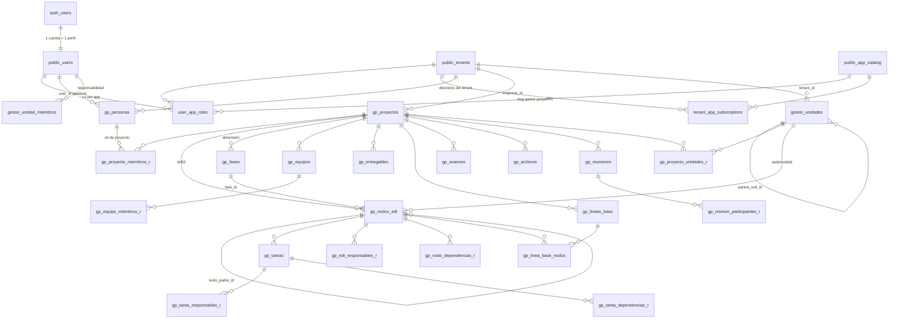

# Evaluación de pertinencia arquitectónica · Modelo v2 `gp_*` vs. infraestructura real del Qaway Hub

**Fecha:** 12-11-2026
**Ámbito:** Gestor de Proyectos 2 (`src/pages/5-qaway-hub/13-Gestor_Proyectos2`)
**Estado:** evaluación de solo lectura. **No se ejecutó SQL, no se creó/modificó nada en Supabase, no se tocó
infraestructura compartida (`auth`, `users`, `tenants`, `app_catalog`, `user_app_roles`) y no se retiró `localStorage`.**
**Insumo evaluado:** `00_diseno_definitivo_etapa_2a.md`, `01_erd.md`, `02_diccionario_datos.md`,
`03_correspondencia_modelo_antiguo_nuevo.md`, `sql/20261112_0001..0004` y `sql/backfill/20261112_0100`.

---

## §0. Veredicto en una página

El diseño v2 es correcto en su **núcleo de dominio** (proyecto, EDT/WBS, tareas, avances, líneas base,
entregables, reuniones, dependencias, responsables) y **no debe reescribirse**. Pero de las 41 tablas
propuestas, **7 son infraestructura paralela** que el Hub ya resuelve y **1 requiere adaptación** para
dejar de duplicar identidad:

| Clasificación | Tablas |
|---|---|
| **Eliminar del diseño** | `gp_empresa_miembros_r`, `gp_persona_cuentas_r`, `gp_roles_empresa_c`, `gp_ambitos_gobernanza_c`, `gp_unidades_territoriales`, `gp_sedes`, `gp_tipos_unidad_territorial_c` |
| **Reutilizar y adaptar** | `gp_personas` (pasa a directorio del tenant con `user_id` opcional) |
| **Crear (dominio propio GP)** | las 33 restantes |

Resultado: **34 tablas `gp_*` propias**, apoyadas en 5 objetos de plataforma que se reutilizan sin duplicar:

1. `auth.users` + `public.users` → identidad de la cuenta.
2. `public.tenants` → la empresa (tenant).
3. `public.user_app_roles` + `public.app_catalog` + `public.tenant_app_subscriptions` → pertenencia
   usuario × empresa × app, rol de empresa y derecho de uso (plan/suscripción).
4. `public.gestor_unidades` (+ `gestor_unidad_miembros`) → jerarquía organizacional/territorial
   (central, DRE, UGEL, tienda, oficina…), ya existente y ya consumida por el Gestor.
5. Helpers `is_platform_admin()`, `is_tenant_admin()`, `is_tenant_member()`, `get_auth_tenant_id()`,
   `user_can_use_app()`, `user_can_use_feature()` → gobernanza ya implementada.

Además se detectó **un defecto real de seguridad** en `0004`: `gp_is_project_member()` incluye
`gp_is_empresa_member()`, por lo que *cualquier* miembro de la empresa entra a *todos* los proyectos y
la membresía de proyecto queda anulada. Se corrige en §6 y §7.

---

## §1. Evidencia de la auditoría (lo que realmente existe)

### 1.1 Identidad de cuenta

`supabase/migrations/20260812000000_auth_roles_rls.sql` y `20260919153000_strict_tenant_users_rls.sql`:

- `public.users` — **una fila por cuenta**: `id uuid PK → auth.users(id)`, `email`, `full_name`, `avatar_url`,
  `role text CHECK ('admin','editor','viewer','guest')`, `permissions jsonb`, `tenant_id uuid → tenants(id)`,
  `is_platform_admin boolean`, `last_active_at`. Migración posterior añade `last_name`.
- `handle_new_user()` crea la fila al registrarse; `user_invites` (`20260921132000_saas_invites_email_sync.sql`)
  la vincula a un tenant con rol al aceptar la invitación.
- `get_auth_tenant_id()` devuelve `users.tenant_id` (tenant "activo" de la cuenta).
- **No existe `public.profiles`** (verificado: sin coincidencias en `supabase/migrations`).

Conclusión: `users` **no es** un directorio de personas; es el perfil de la cuenta. Todo lo que sea
"persona que participa en un proyecto pero no tiene cuenta" no cabe aquí.

### 1.2 Empresa (tenant) y marca

`20260917130000_create_tenants_multi_tenant.sql`:

- `public.tenants`: `id uuid`, `client_code` (QW-XXXXX), `slug`, `name`, `status`, `branding jsonb`,
  `content jsonb`, `features jsonb`, `payment_settings jsonb`, `deleted_at`. Tenant master
  `00000000-0000-0000-0000-000000000001`. Helpers `get_current_tenant_id()`, `is_tenant_member()`, `is_tenant_admin()`.

### 1.3 Pertenencia usuario × empresa × app y plan (el corazón del reuso)

`20260921130000_saas_apps_plans_permissions.sql`:

- `public.app_catalog`: `id`, `slug`, `name`, `status`… — **semillas actuales: `crm`, `inventario`, `agenda`, `blog`**
  (no existe slug de Gestor de Proyectos).
- `public.tenant_app_subscriptions`: `tenant_id`, `app_id`, `plan` (`basico|intermedio|premium`),
  `status` (`active|trialing|past_due|canceled`), `trial_ends_at`.
- `public.user_app_roles`: `user_id`, `tenant_id`, `app_id`, `role CHECK ('admin','editor','viewer','guest')`,
  índice único `(user_id, tenant_id, app_id)`.
- Helpers: `tenant_app_plan(uuid, text)`, `user_can_use_app(text)` (exige rol de app **y** suscripción
  `active`/`trialing`), `user_app_role(text)`, y en `20260930140000` `user_can_use_feature(app, feature)`
  + `tenant_has_app_feature(tenant, app, feature)`.

Este bloque **es exactamente** la gobernanza empresa/app que el diseño v2 quiso inventar con
`gp_empresa_miembros_r` + `gp_roles_empresa_c` + `gp_ambitos_gobernanza_c`.

### 1.4 Administración de plataforma

- `20260921133000_platform_vs_brand_admin.sql` + `20260930160000_fix_platform_admin_fallback.sql`:
  `is_platform_admin()` = `users.role='admin' AND (is_platform_admin OR tenant_id IS NULL)`; `is_admin()` es su alias.
- `20260922165000_fase_b_roles_manager_fix_permissions_hardening.sql`: `is_tenant_admin()`, `is_tenant_member()`,
  RPC `admin_assign_user_tenant(...)` y trigger anti-escalada de privilegios (v4).

### 1.5 Organización operativa ya existente (la duplicación más costosa)

`20261106000000_gestor_organizacion_operativa.sql`:

- `public.gestor_unidades`: `id uuid`, `tenant_id → tenants`, `parent_unit_id → gestor_unidades`,
  `name`, `code`, **`unit_type text`** (sin CHECK; en código `central|dre|ugel|obra|jefatura|tienda|oficina|departamento|other`),
  `region`, `macroregion`, `address`, `status (active|inactive|archived)`, `metadata jsonb`.
- `public.gestor_unidad_miembros`: `unit_id`, `user_id → users`, `responsibility`, `is_primary`, `status`.
- `public.gestor_proyecto_unidades`: `project_id **text** → gestor_proyectos(id)`, `unit_id → gestor_unidades`.
- `gestor_proyectos` recibió `tenant_id` y `central_unit_id`.
- **Consumidor real:** únicamente `13-Gestor_Proyectos2/src/services/gestorOrganizacionService.ts`
  (`listGestorUnits`, `listGestorUnitMembers`, `listGestorUnitProjects`, `upsertGestorUnit`).
  La app 11 (`11-gestor-de-proyectos`) **no la referencia** (grep sin coincidencias).
- Su RLS sigue siendo permisiva por diseño ("Preparación solamente: no se cambian las políticas permisivas").

Conclusión: `gp_sedes`, `gp_unidades_territoriales` y `gp_tipos_unidad_territorial_c` son una segunda
jerarquía organizacional para el mismo tenant. Deben desaparecer del diseño.

### 1.6 Cómo consumen hoy la identidad las apps

- `src/router/HubAccessGuard.jsx`: exige sesión, lee `users.tenant_id`, `users.is_platform_admin`,
  `users.role` y `tenants`; bloquea por app con `user_can_use_app`/plan.
- `src/config/auth.js`: cliente Supabase compartido (`https://qrusdsqgygfolxfrafyd.supabase.co`), storageKey
  por defecto `sb-<ref>-auth-token`.
- `13-Gestor_Proyectos2/src/services/supabaseClient.ts`: **mismo proyecto** pero
  `storageKey: 'qaway_gestor_proyectos_auth'` → **sesión separada del Hub**; no hay `getSession`/`signIn`,
  el Gestor 2 **no resuelve usuario autenticado** hoy.
- `13-Gestor_Proyectos2/src/context` (equipo/usuarios/sedes): datos locales/mock, sin persistencia.
- `11-gestor-de-proyectos/src/context/TenantContext.tsx`: lista estática `PROJECT_ORGANIZATIONS`, no consulta `tenants`.

Esto es una **brecha de integración** a declarar, no a corregir en esta etapa (requiere aprobación).

### 1.7 Lo que el Hub NO tiene (justifica tablas nuevas)

- No hay tabla de metadatos de archivos: solo buckets de Storage `resources`, `products`, `avatars`
  (`20260924000000_storage_resources_logos.sql`) → `gp_archivos` se crea.
- No hay tabla de auditoría genérica ni de migraciones → `gp_eventos_auditoria`, `gp_corridas_migracion` se crean.
- No hay nada de EDT/WBS, tareas, avances, líneas base, entregables, reuniones, dependencias → todo eso es dominio GP.
- `territory_ugel_monitoring` (demo MINEDU, `id text`, RLS `using(true)`) es de otra app: **no reutilizable**.

---

## §2. Matriz de las 41 tablas `gp_*`

Leyenda de **Evaluación**: `CREAR` = dominio propio sin equivalente · `ADAPTAR` = existe algo que cubre
parte, se conserva la tabla con cambios · `ELIMINAR` = sustituida por infraestructura del Hub.

### 2.1 Catálogos (`_c`, 15 tablas)

| # | Necesidad | Infraestructura existente | Tabla `gp_*` propuesta | Evaluación | Decisión recomendada |
|---|---|---|---|---|---|
| 1 | Estados del proyecto | Ninguna | `gp_estados_proyecto_c` | CREAR | Mantener. Vocabulario GP puro; no confundir con `tenants.status`. |
| 2 | Tipos de proyecto | Ninguna (`features jsonb` no sirve como catálogo) | `gp_tipos_proyecto_c` | CREAR | Mantener. |
| 3 | Estados de tarea | Ninguna | `gp_estados_tarea_c` | CREAR | Mantener. |
| 4 | Prioridades | Ninguna | `gp_prioridades_c` | CREAR | Mantener. |
| 5 | Rol del usuario **en la empresa** | `user_app_roles.role` (`admin/editor/viewer/guest`) + `users.role` + `is_tenant_admin()` | `gp_roles_empresa_c` | **ELIMINAR** | Rol de empresa se lee de `user_app_roles` para la app del Gestor. Borrar catálogo y su seed (0001 línea 208). |
| 6 | Rol del usuario **en el proyecto** | Ninguna — los roles globales **no** otorgan permisos de proyecto | `gp_roles_proyecto_c` | CREAR | Mantener (`administrador/gestor/coordinador/supervisor/colaborador/lector`). Es la pieza que justifica no reutilizar roles globales. |
| 7 | Ámbito de gobernanza (global/empresa/proyecto) | Plataforma: `is_platform_admin()` / `user_app_roles` / (proyecto = GP) | `gp_ambitos_gobernanza_c` | **ELIMINAR** | El ámbito es estructural (dónde vive la fila), no un dato de negocio. No hace falta catálogo. |
| 8 | Tipos de dependencia (FS/SS/FF/SF) | Ninguna | `gp_tipos_dependencia_c` | CREAR | Mantener. |
| 9 | Tipos de entregable | Ninguna | `gp_tipos_entregable_c` | CREAR | Mantener. |
| 10 | Estados de entregable | Ninguna | `gp_estados_entregable_c` | CREAR | Mantener. |
| 11 | Tipos de reunión | Ninguna (`agenda` es otra app) | `gp_tipos_reunion_c` | CREAR | Mantener. |
| 12 | Estados de reunión | Ninguna | `gp_estados_reunion_c` | CREAR | Mantener. |
| 13 | Tipos de unidad organizacional/territorial | `gestor_unidades.unit_type` (texto libre, sin catálogo) | `gp_tipos_unidad_territorial_c` | **ELIMINAR** | Validar el conjunto (`central/dre/ugel/red/gre/tienda/oficina/...`) en código + `CHECK` aditivo en `gestor_unidades`, no en una tabla GP paralela. |
| 14 | Tipos de avance | Ninguna | `gp_tipos_avance_c` | CREAR | Mantener. |
| 15 | Tipos de archivo | Solo buckets de Storage, sin catálogo | `gp_tipos_archivo_c` | CREAR | Mantener. |

### 2.2 Entidades principales (8 tablas)

| # | Necesidad | Infraestructura existente | Tabla `gp_*` propuesta | Evaluación | Decisión recomendada |
|---|---|---|---|---|---|
| 16 | El proyecto | `tenants` (empresa) y `gestor_proyectos` (legado, `id text`) | `gp_proyectos` | CREAR | Mantener con `empresa_id → tenants(id)` (FK real, hoy comentada) y `legacy_source_id → gestor_proyectos.id`. |
| 17 | Personas que participan (con o sin cuenta) | `auth.users`/`public.users` solo cubre cuentas; no hay directorio de personas sin cuenta | `gp_personas` | **ADAPTAR** | Mantener como **directorio del tenant**: `empresa_id NOT NULL`, `user_id uuid → users(id)` opcional, `UNIQUE (empresa_id, user_id) WHERE user_id IS NOT NULL`. Sustituye a `gp_persona_cuentas_r`. |
| 18 | Fase del proyecto (dimensión, no EDT) | Ninguna | `gp_fases` | CREAR | Mantener. |
| 19 | Nodo EDT/WBS | Ninguna | `gp_nodos_edt` | CREAR | Mantener, con dos correcciones: FK de sede/unidad → `gestor_unidades(id)` y arreglo del `CHECK kind` (§7.3). |
| 20 | Tarea | Ninguna | `gp_tareas` | CREAR | Mantener. |
| 21 | Equipo de trabajo | `gestor_unidad_miembros` cubre "miembros de una unidad", no equipos de proyecto | `gp_equipos` | CREAR | Mantener con `proyecto_id` (equipo con alcance de proyecto). No sustituye a `gestor_unidad_miembros`. |
| 22 | Unidad organizacional/territorial (DRE/UGEL/RED/GRE) | **`public.gestor_unidades`** (`tenant_id`, `parent_unit_id`, `unit_type`, `region`, `macroregion`, `address`, `status`, `metadata`) | `gp_unidades_territoriales` | **ELIMINAR** | Usar `gestor_unidades`. Solo añadir (aditivo) `legacy_source_id text` e `is_deleted boolean` para el backfill y el borrado lógico. |
| 23 | Sede / local / oficina | `gestor_unidades` con `unit_type='oficina'/'tienda'` + `parent_unit_id` + `address` | `gp_sedes` | **ELIMINAR** | Modelar sedes como unidades hijas de tipo sede/oficina en `gestor_unidades`. |

### 2.3 Entidades operativas (8 tablas)

| # | Necesidad | Infraestructura existente | Tabla `gp_*` propuesta | Evaluación | Decisión recomendada |
|---|---|---|---|---|---|
| 24 | Entregable | Ninguna | `gp_entregables` | CREAR | Mantener. |
| 25 | Línea base (versión aprobada) | Ninguna | `gp_lineas_base` | CREAR | Mantener. |
| 26 | Snapshot de nodos en la línea base | Ninguna | `gp_linea_base_nodos` | CREAR | Mantener. |
| 27 | Reporte de avance | Ninguna | `gp_avances` | CREAR | Mantener. |
| 28 | Archivo/adjunto con metadatos | Solo buckets `resources/products/avatars` (sin tabla de metadatos) | `gp_archivos` | CREAR | Mantener. Reusar bucket `resources` con prefijo `gp/<empresa_id>/…`; no crear bucket nuevo aún. |
| 29 | Reunión | Ninguna | `gp_reuniones` | CREAR | Mantener. |
| 30 | Auditoría de cambios | Ninguna tabla de auditoría genérica en el Hub | `gp_eventos_auditoria` | CREAR | Mantener, con `actor_user_id → auth.users` y `actor_persona_id → gp_personas`. |
| 31 | Corrida de migración (idempotencia) | Ninguna | `gp_corridas_migracion` | CREAR | Mantener; es el control del backfill. |

### 2.4 Relaciones (`_r`, 10 tablas)

| # | Necesidad | Infraestructura existente | Tabla `gp_*` propuesta | Evaluación | Decisión recomendada |
|---|---|---|---|---|---|
| 32 | Cuenta ↔ persona | `users` ya es 1 fila por cuenta; `persona_cuentas` permitía N cuentas por persona (no es requisito) | `gp_persona_cuentas_r` | **ELIMINAR** | Colapsar en `gp_personas.user_id` (1 cuenta por persona y empresa). |
| 33 | Pertenencia usuario ↔ empresa (y su rol) | **`user_app_roles`** `(user_id, tenant_id, app_id, role)` + `tenants` + `is_tenant_admin()` | `gp_empresa_miembros_r` | **ELIMINAR** | Es la duplicación más grave: crearía un segundo padrón de miembros. `user_app_roles` es la fuente única. |
| 34 | Miembro de proyecto + rol de proyecto | Ninguna | `gp_proyecto_miembros_r` | CREAR | Mantener: es el eje del permiso de escritura (§6). |
| 35 | Miembro de equipo | Ninguna | `gp_equipo_miembros_r` | CREAR | Mantener. |
| 36 | Responsables de nodo EDT | Ninguna | `gp_edt_responsables_r` | CREAR | Mantener. |
| 37 | Responsables de tarea | Ninguna | `gp_tarea_responsables_r` | CREAR | Mantener. |
| 38 | Dependencias entre nodos | Ninguna | `gp_nodo_dependencias_r` | CREAR | Mantener. |
| 39 | Dependencias entre tareas | Ninguna | `gp_tarea_dependencias_r` | CREAR | Mantener. |
| 40 | Participantes de reunión | Ninguna | `gp_reunion_participantes_r` | CREAR | Mantener. |
| 41 | Alcance del proyecto (unidad/sede) | `gestor_proyecto_unidades` existe pero su PK es `project_id **text**` → `gestor_proyectos(id)` legado: **no puede** referenciar `gp_proyectos(uuid)` | `gp_proyecto_unidades_r` | CREAR | Mantener, apuntando a `gestor_unidades(id)`. `gestor_proyecto_unidades` queda como legado a retirar en el cutover (no ahora). |

**Totales:** 33 CREAR · 1 ADAPTAR (`gp_personas`) · 7 ELIMINAR · 0 pendientes de clasificación.

---

## §3. Diagrama de integración Hub ↔ Gestor



Regla de oro del diagrama: **el Gestor nunca posee identidad ni empresa**. Todo lo que es "quién es"
y "a qué empresa pertenece" se lee del Hub; el Gestor solo aporta el dominio de proyectos y la
participación *dentro* del proyecto (`gp_proyecto_miembros_r` + `gp_roles_proyecto_c`).

---

## §4. Listas de decisión

### 4.1 Infraestructura del Hub que el Gestor **reutiliza tal cual** (no se toca)

| Objeto | Se usa para |
|---|---|
| `auth.users` | Sesión y `auth.uid()`. |
| `public.users` | Perfil de la cuenta (`full_name`, `email`, `avatar_url`, `role`, `is_platform_admin`, `tenant_id`). |
| `public.tenants` | La empresa: `gp_proyectos.empresa_id`, `gp_personas.empresa_id`, `gestor_unidades.tenant_id`. |
| `public.user_app_roles` | Pertenencia usuario × empresa × app y **rol de empresa** (`admin/editor/viewer/guest`). |
| `public.app_catalog` | Identifica la app por `slug`. |
| `public.tenant_app_subscriptions` | Derecho de uso (plan activo/trial). |
| `public.gestor_unidades` / `gestor_unidad_miembros` | Jerarquía organizacional y territorial + responsables por unidad. |
| `public.user_invites`, `admin_assign_user_tenant` | Alta de usuarios en la empresa (flujo ya existente). |
| Helpers `is_platform_admin()`, `is_admin()`, `is_tenant_admin()`, `is_tenant_member()`, `get_auth_tenant_id()`, `user_can_use_app()`, `user_can_use_feature()`, `tenant_app_plan()` | Gobernanza/RPC. |

### 4.2 Añadidos **aditivos** necesarios en infraestructura existente (requieren aprobación aparte)

| Objeto | Cambio propuesto | Por qué |
|---|---|---|
| `gestor_unidades` | `+ legacy_source_id text`, `+ is_deleted boolean DEFAULT false` | Backfill idempotente desde `gp_sedes`/`gp_unidades_territoriales` y borrado lógico. |
| `gestor_unidades` | `+ CHECK unit_type IN (...)` (validación del dominio) | Sustituye a `gp_tipos_unidad_territorial_c`. |
| `app_catalog` | **Semilla** de `slug='gestor-proyectos'` + suscripción por tenant | Prerrequisito de plataforma. **No se inserta ahora**; lo decide el dueño del Hub. |
| RLS de `gestor_unidades` / `gestor_unidad_miembros` / `gestor_proyecto_unidades` | Endurecer (hoy permisivas) | Sin esto, el Gestor hereda políticas `using(true)` vía PostgREST. Debe coordinarse con app 11. |

### 4.3 Tablas propias del Gestor (34)

Catálogos (12): `gp_estados_proyecto_c`, `gp_tipos_proyecto_c`, `gp_estados_tarea_c`, `gp_prioridades_c`,
`gp_roles_proyecto_c`, `gp_tipos_dependencia_c`, `gp_tipos_entregable_c`, `gp_estados_entregable_c`,
`gp_tipos_reunion_c`, `gp_estados_reunion_c`, `gp_tipos_avance_c`, `gp_tipos_archivo_c`.

Principales (6): `gp_proyectos`, `gp_personas` (adaptada), `gp_fases`, `gp_nodos_edt`, `gp_tareas`, `gp_equipos`.

Operativas (8): `gp_entregables`, `gp_lineas_base`, `gp_linea_base_nodos`, `gp_avances`, `gp_archivos`,
`gp_reuniones`, `gp_eventos_auditoria`, `gp_corridas_migracion`.

Relaciones (8): `gp_proyecto_miembros_r`, `gp_equipo_miembros_r`, `gp_edt_responsables_r`,
`gp_tarea_responsables_r`, `gp_nodo_dependencias_r`, `gp_tarea_dependencias_r`,
`gp_reunion_participantes_r`, `gp_proyecto_unidades_r`.

### 4.4 A eliminar del diseño (7) y su sustituto

| Tabla eliminada | Sustituto | Acción en SQL |
|---|---|---|
| `gp_empresa_miembros_r` | `user_app_roles` (+ `is_tenant_admin()`) | Quitar bloque en 0003 y helpers que la citan en 0004. |
| `gp_persona_cuentas_r` | `gp_personas.user_id` | Quitar bloque en 0003. |
| `gp_roles_empresa_c` | `user_app_roles.role` | Quitar tabla y seed en 0001. |
| `gp_ambitos_gobernanza_c` | Estructura de plataforma (global/app/tenant) | Quitar tabla (+ seed si existe) en 0001. |
| `gp_unidades_territoriales` | `gestor_unidades` | Quitar tabla en 0002; repuntar FKs. |
| `gp_sedes` | `gestor_unidades` (`unit_type` sede/oficina) | Quitar tabla en 0002; repuntar FKs. |
| `gp_tipos_unidad_territorial_c` | `unit_type` + `CHECK` | Quitar tabla y seed en 0001. |

---

## §5. Relaciones y FKs definitivas

### 5.1 Hacia el Hub (claves "de plataforma")

```
gp_proyectos.empresa_id            → public.tenants(id) ON DELETE RESTRICT
gp_personas.empresa_id             → public.tenants(id) ON DELETE RESTRICT   (NOT NULL)
gp_personas.user_id                → public.users(id) ON DELETE SET NULL     (opcional)
gp_equipos.empresa_id              → public.tenants(id)
gp_* (todas las tablas con empresa_id) → public.tenants(id)                  (consistencia, no confianza)
gp_nodos_edt.sede_unidad_id        → public.gestor_unidades(id) ON DELETE SET NULL
gp_proyecto_unidades_r.unidad_id   → public.gestor_unidades(id) ON DELETE CASCADE
gp_eventos_auditoria.actor_user_id → auth.users(id) ON DELETE SET NULL       (sin FK dura si molesta: dejar uuid)
```

Regla: **no hay FK de `gp_*` a `user_app_roles`**. La pertenencia se evalúa en RLS (función), no por FK,
porque es una relación N:M cuya autoridad es la plataforma.

### 5.2 Dentro del dominio GP (sin cambios respecto al diseño, salvo lo indicado)

```
gp_fases.proyecto_id               → gp_proyectos(id) ON DELETE RESTRICT
gp_nodos_edt.proyecto_id           → gp_proyectos(id) ON DELETE RESTRICT
gp_nodos_edt.nodo_padre_id         → gp_nodos_edt(id) ON DELETE RESTRICT
gp_nodos_edt.fase_id               → gp_fases(id) ON DELETE SET NULL
gp_nodos_edt.sede_unidad_id        → gestor_unidades(id) ON DELETE SET NULL   (antes 2 FKs gp_*)
gp_tareas.proyecto_id              → gp_proyectos(id)
gp_tareas.nodo_edt_id              → gp_nodos_edt(id) ON DELETE SET NULL
gp_equipos.proyecto_id             → gp_proyectos(id) ON DELETE SET NULL
gp_entregables.proyecto_id         → gp_proyectos(id)
gp_lineas_base.proyecto_id         → gp_proyectos(id)
gp_linea_base_nodos.linea_base_id  → gp_lineas_base(id) ON DELETE CASCADE
gp_linea_base_nodos.nodo_edt_id    → gp_nodos_edt(id) ON DELETE RESTRICT
gp_avances.proyecto_id             → gp_proyectos(id)
gp_avances.registrado_por_persona_id → gp_personas(id) ON DELETE SET NULL
gp_archivos.proyecto_id            → gp_proyectos(id) ON DELETE SET NULL
gp_reuniones.proyecto_id           → gp_proyectos(id)
gp_eventos_auditoria.actor_persona_id → gp_personas(id) ON DELETE SET NULL
gp_proyecto_miembros_r.proyecto_id → gp_proyectos(id) ON DELETE CASCADE
gp_proyecto_miembros_r.persona_id  → gp_personas(id) ON DELETE CASCADE
gp_equipo_miembros_r.equipo_id     → gp_equipos(id) ON DELETE CASCADE
gp_edt_responsables_r.nodo_edt_id  → gp_nodos_edt(id) ON DELETE CASCADE
gp_tarea_responsables_r.tarea_id   → gp_tareas(id) ON DELETE CASCADE
gp_nodo_dependencias_r (predecesor/sucesor) → gp_nodos_edt(id) ON DELETE CASCADE
gp_tarea_dependencias_r (predecesora/sucesora) → gp_tareas(id) ON DELETE CASCADE
gp_reunion_participantes_r.reunion_id → gp_reuniones(id) ON DELETE CASCADE
gp_proyecto_unidades_r.proyecto_id → gp_proyectos(id) ON DELETE CASCADE
gp_proyecto_unidades_r.unidad_id   → gestor_unidades(id) ON DELETE CASCADE
```

### 5.3 Restricciones de unicidad que sostienen la idempotencia

```
gp_proyectos           UNIQUE (empresa_id, codigo_proyecto) WHERE is_deleted = false     (ya existe)
gp_personas            UNIQUE (empresa_id, user_id) WHERE user_id IS NOT NULL            (nuevo, sustituye persona_cuentas)
gp_personas            UNIQUE (empresa_id, tipo_documento, numero_documento) WHERE ...    (ya existe, parcial)
gp_proyecto_miembros_r UNIQUE (proyecto_id, persona_id)                                  (ya existe)
gp_proyecto_unidades_r UNIQUE (proyecto_id, unidad_id)                                    (nuevo, evita duplicados de alcance)
```

---

## §6. Implicaciones de RLS

### 6.1 El defecto actual (0004)

```sql
-- estado actual, simplificado
gp_is_empresa_member(empresa_id)  →  basada en gp_empresa_miembros_r
gp_is_project_member(proyecto_id) →  gp_is_project_member OR gp_is_empresa_member(p.empresa_id)
```

Consecuencia: **cualquier** miembro de la empresa obtiene acceso a **todos** los proyectos, y como
`gp_empresa_miembros_r` se elimina, la función además quedaría sin fuente. Es un doble defecto:
sobre-permiso y dependencia de una tabla que no debe existir.

### 6.2 Helpers propuestos (reemplazan los de 0004)

```sql
-- 1) Acceso a la app en una empresa concreta (NO usa get_auth_tenant_id: soporta multiempresa)
create or replace function public.gp_has_app_access(p_empresa_id uuid)
returns boolean language sql stable security definer set search_path = public as $$
  select public.is_platform_admin()
    or exists (
      select 1
      from public.user_app_roles uar
      join public.app_catalog a on a.id = uar.app_id
      join public.tenant_app_subscriptions tas
        on tas.tenant_id = uar.tenant_id and tas.app_id = uar.app_id
      where uar.user_id = auth.uid()
        and uar.tenant_id = p_empresa_id
        and a.slug = 'gestor-proyectos'
        and (tas.status = 'active'
             or (tas.status = 'trialing' and (tas.trial_ends_at is null or tas.trial_ends_at > now())))
    );
$$;

-- 2) Rol de empresa del usuario (null si no pertenece)
create or replace function public.gp_empresa_role(p_empresa_id uuid)
returns text language sql stable security definer set search_path = public as $$
  select uar.role
  from public.user_app_roles uar
  join public.app_catalog a on a.id = uar.app_id
  where uar.user_id = auth.uid() and uar.tenant_id = p_empresa_id
    and a.slug = 'gestor-proyectos'
  limit 1;
$$;

-- 3) Escritura en la empresa (admin/editor de la app, o admin del tenant)
create or replace function public.gp_can_write_empresa(p_empresa_id uuid)
returns boolean language sql stable security definer set search_path = public as $$
  select public.is_platform_admin()
    or public.gp_empresa_role(p_empresa_id) in ('admin','editor');
$$;

-- 4) Persona del usuario en esa empresa (para created_by / responsables)
create or replace function public.gp_persona_actual(p_empresa_id uuid)
returns uuid language sql stable security definer set search_path = public as $$
  select p.id from public.gp_personas p
  where p.user_id = auth.uid() and p.empresa_id = p_empresa_id and p.is_deleted = false
  limit 1;
$$;

-- 5) Pertenencia al proyecto (SOLO la tabla de proyecto: sin bypass de empresa)
create or replace function public.gp_is_project_member(p_proyecto_id uuid)
returns boolean language sql stable security definer set search_path = public as $$
  select exists (
    select 1
    from public.gp_proyecto_miembros_r m
    join public.gp_personas p on p.id = m.persona_id
    where m.proyecto_id = p_proyecto_id
      and p.user_id = auth.uid()
      and m.estado = 'activo'
  );
$$;

-- 6) Rol de proyecto del usuario (para decidir escritura fina)
create or replace function public.gp_project_role(p_proyecto_id uuid)
returns text language sql stable security definer set search_path = public as $$
  select m.rol_proyecto_codigo
  from public.gp_proyecto_miembros_r m
  join public.gp_personas p on p.id = m.persona_id
  where m.proyecto_id = p_proyecto_id and p.user_id = auth.uid() and m.estado = 'activo'
  limit 1;
$$;
```

> **Ojo con el nombre de la columna de trial:** verificar en `tenant_app_subscriptions` si es
> `trial_ends_at` (usado por `user_can_use_app`) o `trial_ends_at`; alinear con la definición vigente
> antes de aplicar. Se deja anotado como punto de verificación en §8.

### 6.3 Matriz de políticas (lectura vs escritura, por familia de tablas)

| Familia | SELECT | INSERT/UPDATE/DELETE |
|---|---|---|
| Catálogos `_c` | `true` (catálogo global de referencia) | Solo plataforma (`is_platform_admin()`), vía migración, no desde la app |
| `gp_proyectos`, `gp_personas`, `gp_equipos` | `gp_has_app_access(empresa_id)` | `gp_can_write_empresa(empresa_id)` |
| Tablas con `proyecto_id` (nodos, tareas, fases, entregables, líneas base, avances, archivos, reuniones, dependencias, responsables, participantes) | `gp_has_app_access(empresa_id)` **y** (`gp_project_role(proyecto_id) is not null` **o** `gp_can_write_empresa(empresa_id)`) | `gp_project_role(proyecto_id) in ('administrador','gestor','coordinador')` **o** `gp_can_write_empresa(empresa_id)` |
| `gp_proyecto_miembros_r` | ídem proyecto | `gp_project_role(proyecto_id) in ('administrador','gestor')` o `gp_can_write_empresa` |
| `gp_eventos_auditoria` | `gp_has_app_access(empresa_id)` | INSERT libre autenticado; sin UPDATE/DELETE |
| `gp_corridas_migracion` | Solo `is_platform_admin()` | Solo `is_platform_admin()` (servicio) |
| `gestor_unidades` (Hub) | Pendiente: hoy permisiva | Pendiente: endurecer en coordinación con app 11 |

### 6.4 Consecuencias prácticas

1. **Gobernanza en 3 ámbitos, sin tabla nueva:** global = `is_platform_admin()`; empresa = `user_app_roles`
   (vía `gp_empresa_role`); proyecto = `gp_proyecto_miembros_r` + `gp_roles_proyecto_c`.
2. Un `admin` de empresa **no** entra automáticamente a un proyecto: solo si está en `gp_proyecto_miembros_r`
   (o si es admin/editor de la app, que sí puede administrar la cartera). Esto es una **decisión de producto**
   que debe confirmarse (§8).
3. `service_role` (backfill, scripts) salta RLS: el backfill debe ejecutarse con la service key y `empresa_id`
   explícito, nunca confiando en `auth.uid()`.
4. `get_auth_tenant_id()` **no** se usa en las políticas GP: es "la empresa activa" de la cuenta y bloquearía
   a usuarios con acceso a varias empresas.

---

## §7. Cambios concretos necesarios en las migraciones 0001–0004 y en el backfill

> Todos son cambios **en los archivos del diseño**, no ejecuciones. Al aplicarse, el conteo pasa de
> 41 a 34 `CREATE TABLE gp_*` y de 4 a 6 funciones helper (se van 3, entran 6).

### 7.1 `0001_gp_catalogos_base.sql`

| Acción | Detalle |
|---|---|
| Eliminar | `CREATE TABLE gp_roles_empresa_c` (línea 66) y su `INSERT` (línea 208). |
| Eliminar | `CREATE TABLE gp_ambitos_gobernanza_c` (línea 94) y su seed si lo tiene. |
| Eliminar | `CREATE TABLE gp_tipos_unidad_territorial_c` (línea 167) y su `INSERT` (línea 216). |
| Mantener | Los 12 catálogos restantes con sus seeds. |
| Añadir | Comentario de cabecera: "los roles de empresa y ámbitos de gobernanza los provee la plataforma (`user_app_roles`, `is_platform_admin`), no este esquema". |

### 7.2 `0002_gp_entidades_principales.sql`

| Acción | Detalle |
|---|---|
| `gp_proyectos` | Convertir el comentario de `empresa_id` en FK real `REFERENCES public.tenants(id) ON UPDATE CASCADE ON DELETE RESTRICT`. |
| `gp_proyectos` | `empresa_id` → `NOT NULL` (todo proyecto pertenece a una empresa). |
| `gp_personas` | `+ user_id uuid REFERENCES public.users(id) ON UPDATE CASCADE ON DELETE SET NULL`. |
| `gp_personas` | `empresa_id` → `NOT NULL`; `+ UNIQUE INDEX (empresa_id, user_id) WHERE user_id IS NOT NULL`. |
| `gp_nodos_edt` | Reemplazar `sede_id` y `unidad_territorial_id` por **una** columna `sede_unidad_id uuid REFERENCES public.gestor_unidades(id) ON DELETE SET NULL`. |
| `gp_nodos_edt` | Corregir `CHECK (kind IN ('hito','subproceso'))`: no cubre `COMPONENTE|PRODUCTO|ENTREGABLE|PAQUETE_TRABAJO` que la taxonomía de ETAPA 1 usa. Dejar `kind` como `text` con CHECK de los 5 tipos **o** eliminarlo y derivarlo de `is_entregable` + posición en el árbol (recomendado: derivarlo; `edt_type_cached` ya es cache). |
| Eliminar | `CREATE TABLE gp_unidades_territoriales` (línea 181). |
| Eliminar | `CREATE TABLE gp_sedes` (línea 205). |
| Eliminar | Los `ALTER TABLE ... ADD CONSTRAINT` que apuntan a `gp_sedes`/`gp_unidades_territoriales` (líneas ~228+). |
| Mantener | `gp_fases`, `gp_tareas`, `gp_equipos` sin cambios. |

### 7.3 `0003_gp_entidades_operativas_y_relaciones.sql`

| Acción | Detalle |
|---|---|
| Eliminar | `CREATE TABLE gp_persona_cuentas_r` (línea 204). |
| Eliminar | `CREATE TABLE gp_empresa_miembros_r` (línea ~219) y sus índices únicos. |
| `gp_proyecto_unidades_r` | Sustituir `unidad_territorial_id` y `sede_id` por `unidad_id uuid NOT NULL REFERENCES public.gestor_unidades(id) ON DELETE CASCADE`; ajustar el CHECK a `unidad_id IS NOT NULL`; `+ UNIQUE (proyecto_id, unidad_id)`. |
| Mantener | `gp_entregables`, `gp_lineas_base`, `gp_linea_base_nodos`, `gp_avances`, `gp_archivos`, `gp_reuniones`, `gp_eventos_auditoria`, `gp_corridas_migracion` y las 8 relaciones restantes. |
| Revisar | FK diferida `gp_archivos.reunion_id` → convertirla en FK real (la tabla `gp_reuniones` se crea en el mismo archivo, antes de la línea 106). |

### 7.4 `0004_gp_funciones_triggers_rls_indices.sql`

| Acción | Detalle |
|---|---|
| Eliminar | `gp_auth_empresa_id()` (fallback a `gp_empresa_miembros_r`). |
| Eliminar | `gp_is_empresa_member()` (sin tabla fuente; sustituida). |
| Reescribir | `gp_is_project_member()` → solo `gp_proyecto_miembros_r` + `gp_personas.user_id` (sin bypass de empresa). |
| Añadir | `gp_has_app_access(uuid)`, `gp_empresa_role(uuid)`, `gp_can_write_empresa(uuid)`, `gp_persona_actual(uuid)`, `gp_project_role(uuid)` (§6.2). |
| Mantener | `gp_set_updated_at()` y sus triggers; `gp_is_platform_admin()` puede quedarse como alias de `public.is_platform_admin()` (evita divergencia). |
| Reescribir | Todas las políticas que citaban `gp_is_empresa_member`/`gp_empresa_miembros_r`, aplicando la matriz de §6.3. |

### 7.5 `backfill/20261112_0100_backfill_idempotente.sql`

| Acción | Detalle |
|---|---|
| `gp_personas` | Insertar desde `gestor_personas`/`localStorage`; `empresa_id` obligatorio (derivar de `gestor_proyectos.tenant_id`); deduplicar por `(empresa_id, tipo_documento, numero_documento)` y `(empresa_id, user_id)`. |
| `gp_personas.user_id` | Resolver por `lower(email)` contra `public.users` **y** con pertenencia en `user_app_roles` al mismo tenant. Si hay ambigüedad, dejar `user_id NULL` y registrar en `gp_corridas_migracion`, sin inventar vínculo. |
| `gp_persona_cuentas_r` | **Suprimir** el bloque de backfill (la relación ya vive en `gp_personas.user_id`). |
| `gp_empresa_miembros_r` | **Suprimir** el bloque: no se migra membresía, la autoridad es `user_app_roles` (no duplicar). |
| `gp_unidades_territoriales` / `gp_sedes` | **Suprimir**; en su lugar, upsert en `public.gestor_unidades` por `(tenant_id, code)` con `unit_type` mapeado (`dre→dre`, `ugel→ugel`, sede→`oficina`) y `legacy_source_id`. |
| `gp_nodos_edt` | Mapear `sede_id`/`unidad_territorial_id` legacy al `unidad_id` resultante en `gestor_unidades`. |
| `gp_proyecto_unidades_r` | Mapear a `unidad_id` del mismo modo. |
| Verificación final | Contar `gp_*` contra legado y guardar el resultado en `gp_corridas_migracion.metadata` (0 huérfanos, 0 duplicados). |

---

## §8. Decisiones pendientes antes de aplicar

1. **Slug de la app en `app_catalog`** (`gestor-proyectos`): lo crea el dueño del Hub. Sin él,
   `gp_has_app_access()` siempre da `false` salvo platform admin.
2. **`gestor_unidades` como jerarquía única**: aceptar sus 2 columnas aditivas y el `CHECK unit_type`
   (afecta a un objeto con RLS permisiva compartida con la app 11).
3. **Política de empresa vs. proyecto**: ¿un `admin`/`editor` de la app puede administrar la cartera
   completa de proyectos, o solo los proyectos donde está en `gp_proyecto_miembros_r`? El diseño actual
   (y §6.3) dice: lectura de cartera sí, escritura delegada a membresía, con `admin/editor` como excepción.
4. **Personas sin cuenta**: confirmar que el Gestor debe poder registrar personas sin cuenta
   (`gp_personas.user_id NULL`) — es lo que justifica mantener `gp_personas` en vez de usar `users`.
5. **Sesión del Gestor 2**: hoy usa `storageKey` propia (`qaway_gestor_proyectos_auth`) y no resuelve
   usuario. Para que la RLS funcione debe compartir sesión con el Hub. **No se cambia en esta etapa**;
   es requisito de la etapa de integración (2D).
6. **Bucket de archivos**: reusar `resources` con prefijo `gp/<empresa_id>/` o crear bucket dedicado.
7. **Nombre definitivo de columna de trial**: confirmar `trial_ends_at` en la versión vigente de
   `tenant_app_subscriptions` (el helper `user_can_use_app` de `20260930140000` ya usa ese nombre).

---

## §9. Qué NO se ha hecho (trazabilidad)

- No se ejecutó ninguna migración ni DDL en Supabase.
- No se creó ni modificó ninguna tabla, política, función o fila en la base compartida.
- No se insertó la semilla de `app_catalog` ni se tocó `tenants`, `users`, `user_app_roles`.
- No se modificó código de la app (ni `supabaseClient.ts` ni el `storageKey`).
- No se retiró `localStorage` ni se hizo cutover de datos.
- No se modificaron `00_diseno_definitivo_etapa_2a.md` ni el SQL: esta evaluación **propone** los cambios
  de §7 y espera aprobación explícita para aplicarlos.
